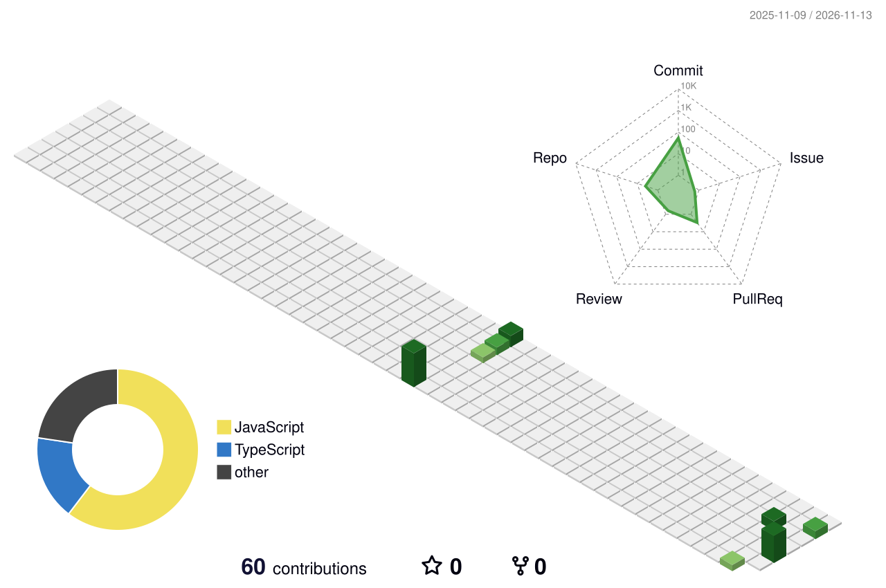

  

  

  
  

---

## 👩‍💻 About Me

- 🎓 Student at **Universitas Negeri Semarang (UNNES)**
- 💻 Frontend developer: React, Laravel, Inertia.js, Tailwind
- 🚀 Active in campus events and entrepreneurship
- 🌱 Currently learning: UI motion, full-stack architecture, Python automation

## 🛠️ Tech Stack

  

## 🏙️ My Contributions

  

## 📊 GitHub Stats

  
  

  

## 📌 Featured Projects

| Project | Description |
|---|---|
| [readme-toolkit](https://github.com/chindyalisya/readme-toolkit) | CLI tool to generate a README.md for your project |

## 📫 Let's Connect

  
  

  

