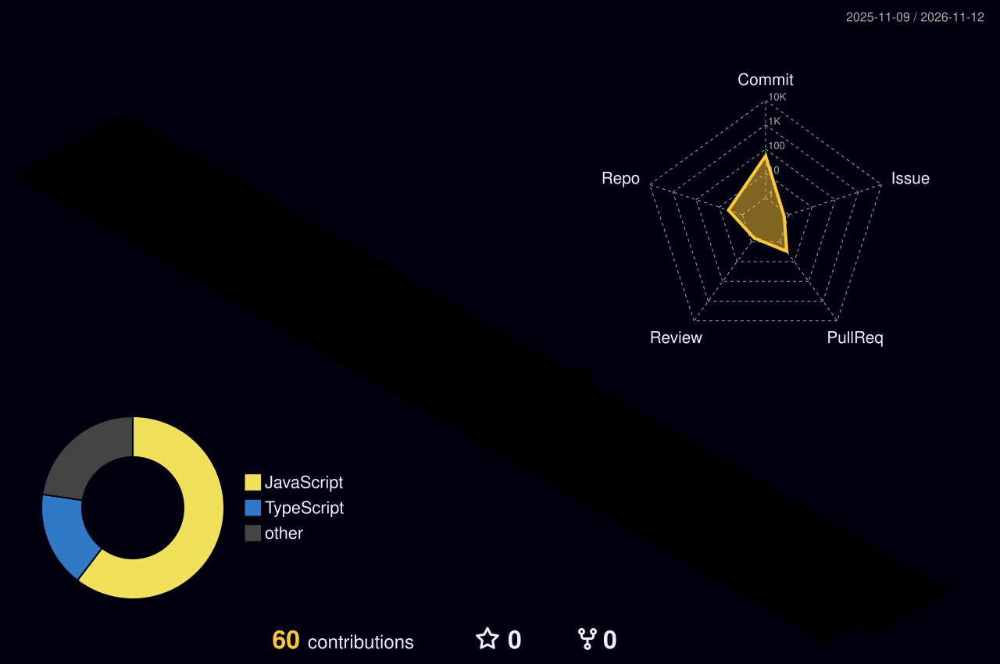

  

  
  
  

<h2 align="center">🏙️ Contribution City</h2>

  

<h2 align="center">🛠️ Tech Stack</h2>

  
  
  
  
  
  
  
  
  

<h2 align="center">📌 Featured Projects</h2>

| Project | Description |
|---|---|
| [readme-toolkit](https://github.com/chindyalisya/readme-toolkit) | CLI tool to generate a README.md for your project |

<h2 align="center">📫 Let's Connect</h2>

  
  

